# Execution Plan

## Detailed Analysis Summary

### Project Scope

- **Project Type**: Greenfield
- **Primary Goal**: Build `FMkorea-Scraper` by inheriting the proven feature, unit, storage, runtime, CLI, container, MCP, retry, and CDK structure from the baseline scraper while replacing site-specific URL/query/parser logic.
- **Primary Requirements Source**: `docs/FMkorea-Scraper_Function_Specification.md`
- **Inheritance Baseline**: `D:\HongDev\ELSAPHABA\DCinside-Scraper`
- **Package Target**: `fmkorea_scraper`
- **Console Script Target**: `fmkorea-scraper`
- **Environment Prefix**: `FMKOREA_`

### Change Impact Assessment

- **User-facing changes**: Yes. CLI, terminal wizard, direct-post collection, board/search collection, deep search, realtime modes, retry commands, container use, and MCP tools must be available.
- **Structural changes**: Yes. A full scraper package, adapter layer, storage layer, checkpoint layer, container contract, MCP adapter, and CDK path are needed.
- **Data model changes**: Yes. FMKorea-specific source JSONL schema must preserve FMKorea metadata and content blocks. The common Polars schema normalization path remains separate.
- **API changes**: Yes. Public Python API, CLI commands, container environment contract, and MCP tool contracts must be defined.
- **NFR impact**: Yes. Security, resiliency, request pacing, parser failure handling, checkpoint/resume, object storage, PostgreSQL checkpoint storage, and property-based testing are in scope.

### Site-Specific Blocking Points

These should be handled inside the relevant AI-DLC UOW question gates rather than assumed silently.

- Board/list/search URL and pagination rules.
- Integrated search and deep search termination rules.
- No-keyword range collection behavior.
- Post detail metadata selectors.
- Body content block detection for text, image, FMKorea video, YouTube, X/Twitter embed, links, and attachments.
- Comment/reply DOM structure and deleted/hidden comment handling.
- Optional user-provided cookie file behavior.
- Parser-failure retry report fields.
- Live smoke test target pages and fixture capture strategy.

### Risk Assessment

- **Risk Level**: Medium
- **Rollback Complexity**: Moderate. The project is greenfield, but it inherits a broad feature surface.
- **Testing Complexity**: Complex. Parser behavior, async collection, checkpointing, storage, retry, and container/MCP contracts all need deterministic tests.
- **Main Risk Control**: Keep DCinside baseline structure, change only site-specific URL/query/parser behavior where possible.

## Workflow Visualization

```mermaid
flowchart TD
    Start(["User Request"])

    subgraph INCEPTION["INCEPTION"]
        WD["Workspace Detection<br/>COMPLETED"]
        RE["Reverse Engineering<br/>SKIPPED"]
        RA["Requirements Analysis<br/>APPROVED"]
        US["User Stories<br/>APPROVED"]
        WP["Workflow Planning<br/>REVIEW REQUIRED"]
        AD["Application Design<br/>EXECUTE"]
        UG["Units Generation<br/>EXECUTE"]
    end

    subgraph CONSTRUCTION["CONSTRUCTION"]
        FD["Functional Design<br/>EXECUTE PER UOW"]
        NFRA["NFR Requirements<br/>EXECUTE PER UOW"]
        NFRD["NFR Design<br/>EXECUTE PER UOW"]
        ID["Infrastructure Design<br/>EXECUTE PER UOW"]
        CG["Code Generation<br/>EXECUTE PER UOW"]
        BT["Build and Test<br/>EXECUTE PER UOW"]
    end

    subgraph OPERATIONS["OPERATIONS"]
        OPS["Operations<br/>PLACEHOLDER"]
    end

    Start --> WD --> RE --> RA --> US --> WP --> AD --> UG
    UG --> FD --> NFRA --> NFRD --> ID --> CG --> BT --> OPS

    style WD fill:#4CAF50,stroke:#1B5E20,stroke-width:3px,color:#fff
    style RE fill:#BDBDBD,stroke:#424242,stroke-width:2px,stroke-dasharray: 5 5,color:#000
    style RA fill:#4CAF50,stroke:#1B5E20,stroke-width:3px,color:#fff
    style US fill:#4CAF50,stroke:#1B5E20,stroke-width:3px,color:#fff
    style WP fill:#FFA726,stroke:#E65100,stroke-width:3px,stroke-dasharray: 5 5,color:#000
    style AD fill:#FFA726,stroke:#E65100,stroke-width:3px,stroke-dasharray: 5 5,color:#000
    style UG fill:#FFA726,stroke:#E65100,stroke-width:3px,stroke-dasharray: 5 5,color:#000
    style FD fill:#FFA726,stroke:#E65100,stroke-width:3px,stroke-dasharray: 5 5,color:#000
    style NFRA fill:#FFA726,stroke:#E65100,stroke-width:3px,stroke-dasharray: 5 5,color:#000
    style NFRD fill:#FFA726,stroke:#E65100,stroke-width:3px,stroke-dasharray: 5 5,color:#000
    style ID fill:#FFA726,stroke:#E65100,stroke-width:3px,stroke-dasharray: 5 5,color:#000
    style CG fill:#FFA726,stroke:#E65100,stroke-width:3px,stroke-dasharray: 5 5,color:#000
    style BT fill:#FFA726,stroke:#E65100,stroke-width:3px,stroke-dasharray: 5 5,color:#000
    style OPS fill:#FFF59D,stroke:#F9A825,stroke-width:2px,color:#000
```

Text alternative: Workspace Detection, Requirements Analysis, and User Stories are complete. Reverse Engineering is skipped because this is a greenfield implementation. Workflow Planning now waits for approval, then Application Design, Units Generation, and per-UOW construction stages execute.

## Phases to Execute

### INCEPTION PHASE

- [x] Workspace Detection - COMPLETED
  - **Rationale**: Workspace type and source/baseline documents were identified.
- [x] Reverse Engineering - SKIPPED
  - **Rationale**: FMKorea implementation is greenfield and has no existing code to reverse engineer.
- [x] Requirements Analysis - APPROVED
  - **Rationale**: Requirements were generated from the FMKorea specification and confirmed.
- [x] User Stories - APPROVED
  - **Rationale**: Personas and stories were generated and approved.
- [x] Workflow Planning - REVIEW REQUIRED
  - **Rationale**: This document defines the remaining execution path.
- [ ] Application Design - EXECUTE
  - **Rationale**: Components, services, public API boundaries, parser boundaries, and storage/checkpoint relationships must be defined before code generation.
- [ ] Units Generation - EXECUTE
  - **Rationale**: The inherited scraper structure is broad enough that implementation must be split into explicit UOWs.

### CONSTRUCTION PHASE

For each UOW, execute:

- [ ] Functional Design - EXECUTE
  - **Rationale**: Each UOW needs domain entities, business rules, and behavior boundaries.
- [ ] NFR Requirements - EXECUTE
  - **Rationale**: Security, resiliency, performance, storage, and parser reliability differ by unit.
- [ ] NFR Design - EXECUTE
  - **Rationale**: Each unit needs concrete implementation patterns for its NFRs.
- [ ] Infrastructure Design - EXECUTE
  - **Rationale**: Most units have no deployable infrastructure, but each must explicitly state its runtime/deployment boundary.
- [ ] Code Generation - EXECUTE
  - **Rationale**: Implementation artifacts must be created.
- [ ] Build and Test - EXECUTE
  - **Rationale**: Deterministic tests, PBT where useful, and smoke checks must validate each unit.

### OPERATIONS PHASE

- [ ] Operations - PLACEHOLDER
  - **Rationale**: Full production operations workflows are future work. CDK deployability is handled in UOW-010.

## Proposed Unit Sequence

Use the baseline sequence and rename only site-specific behavior.

1. **UOW-001 Core Models And Config**
   - Typed config, source/common schemas, public API request/result models, validation, ports.
2. **UOW-002 HTTP Runtime Policy**
   - `httpx` runtime, request delay, retry, timeout, User-Agent rotation, proxy, optional cookie file, block/CAPTCHA classification.
3. **UOW-003 Search And Link Collection**
   - Direct URL parsing, board list/search, integrated search, deep search, no-keyword range, realtime discovery, dedupe.
4. **UOW-004 Post Detail And Content Parsing**
   - Detail metadata, text/body blocks, images, FMKorea video, YouTube, X/Twitter, links, attachments, comments/replies.
5. **UOW-006 Output And Storage**
   - Local JSONL/media, failure records, S3-compatible output with Garage default, common schema export support.
6. **UOW-005 Job Runner And Checkpoint**
   - Link collection to post-worker queue orchestration, lifecycle state, checkpoint/resume, fail-closed CAPTCHA stop.
7. **UOW-007 CLI Adapter**
   - Console script, direct commands, terminal wizard, resume/retry commands, option display and validation.
8. **UOW-008 Container, MCP, And Test Harness**
   - Worker container, PostgreSQL checkpoint adapter, MCP tools, fixture/smoke harness.
9. **UOW-009 Parser Failure Retry Reprocessor**
   - Retry only parser-stage failed posts using failure records/reports/checkpoints.
10. **UOW-010 AWS CDK Infrastructure IaC**
    - Optional AWS deployable infrastructure path for the scraper worker and supporting resources.

Storage is intentionally generated before the job runner so checkpoint commits and output writes have concrete ports available when orchestration is implemented.

## Package Change Sequence

- **Update Approach**: Sequential UOW execution.
- **Critical Path**: UOW-001 -> UOW-002 -> UOW-003 -> UOW-004 -> UOW-006 -> UOW-005 -> UOW-007 -> UOW-008 -> UOW-009 -> UOW-010.
- **Parallelization**: Not recommended during initial generation. Site-specific parser decisions are likely to affect several later units.
- **Coordination Points**: Source JSON schema, common Polars schema, HTTP port, output port, checkpoint port, failure record schema, CLI/container/MCP request models.

## Extension Compliance

- **Security Baseline**: Execute. Cookie/proxy secrets must never appear in logs, JSONL, checkpoints, reports, or failure records.
- **Resiliency Baseline**: Execute. Checkpoint/resume, parser failure records, retry reprocessor, storage errors, and CAPTCHA/block stop behavior are in scope.
- **Property-Based Testing**: Execute. Apply to URL/query builders, config validation, schema serialization, checkpoint ordering invariants, and parser/content block normalization where useful.

## Estimated Timeline

- **Total Inception Stages Remaining**: 2 (`Application Design`, `Units Generation`)
- **Construction Scope**: 10 UOWs, each with Functional Design, NFR Requirements, NFR Design, Infrastructure Design, Code Generation, and Build/Test.
- **Execution Style**: Approval-gated, one stage at a time.

## Success Criteria

- `fmkorea_scraper` can be imported without side effects.
- `fmkorea-scraper` and `python -m fmkorea_scraper.adapters.cli` work.
- Terminal wizard can create the same core Job config as CLI flags.
- Direct-post, board/list/search, integrated search, deep search, no-keyword range, realtime keyword, and realtime full modes are represented.
- Search/list stages collect candidates only; final metadata comes from post detail pages.
- Post detail parsing stores metadata, comments/replies, and content blocks in Polars-friendly JSONL.
- FMKorea source JSON omits `is_repost` and `repost`; common normalization can synthesize defaults later.
- Raw cookie/proxy secret values are never persisted.
- Request pacing, User-Agent rotation, proxy, optional cookie file, and block/CAPTCHA fail-closed behavior are implemented.
- Checkpoint/resume works for normal stops and failure stops.
- Parser-stage failure records can be retried by UOW-009 without rerunning unrelated successful posts.
- Local JSONL/media, S3-compatible object storage, and PostgreSQL checkpoint paths are supported.
- Container, MCP, and AWS CDK paths wrap the same core library behavior.
